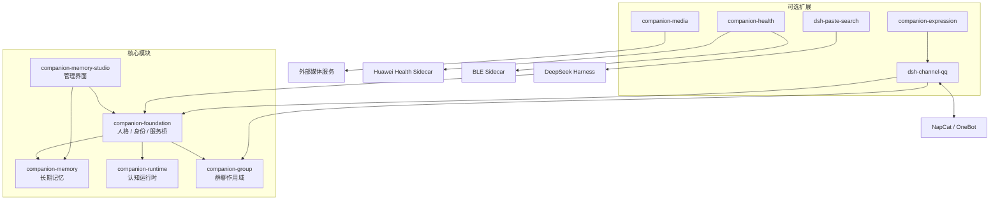

# DSH Companion

**为 DeepSeek Harness 打造的陪伴系统。**

将人格、长期记忆、认知运行时和陪伴空间整合到一个可扩展的插件套件中，让 Agent 不再只是每轮重新开始的聊天窗口，而是能够持续积累信息、管理日常活动并连接外部服务的长期陪伴系统。

DSH Companion 由多个独立插件模块组成，运行在 DeepSeek Harness 之上。核心功能包括人格管理、长期记忆、日程与活动管理，以及用于管理这些能力的 Web UI。QQ、表情包、健康数据和媒体能力则作为可选扩展接入。

## 为什么需要 DSH Companion？

现在的 AI 已经能够很好地理解问题、生成内容，甚至扮演一个性格鲜明的角色。但如果把它作为一个长期陪伴者，仍然存在一些明显的问题。

**每次对话都像重新开始。**

即使 AI 能够记住一些历史信息，也不一定能在合适的时候想起来。过去聊过的事情、共同经历、形成的习惯，很容易随着对话变长而逐渐失去联系。记住一件事和真正理解它对后续关系的影响，是两回事。

**人格往往停留在一份设定里。**

一段提示词可以定义角色的性格、说话方式和兴趣，却很难让这些设定随着真实互动自然发展。角色今天经历了什么、对某件事产生了什么看法、与人的关系发生了什么变化，这些都应该对未来产生影响。

**对话结束，角色的活动也随之停止。**

大多数 AI 助手都是被动响应的。用户发来消息，它才开始工作；用户离开，对话便进入停滞。即使拥有日程和任务功能，也不代表它真的具备持续的状态和活动。

**各种能力彼此割裂。**

记忆、日程、社交、媒体和外部数据通常分散在不同插件中。它们各自能够完成任务，却不一定能够围绕同一个角色形成连贯的经历。

DSH Companion 希望解决的，正是这些问题。

## 我们想实现什么？

我们希望构建的不是一个拥有更多工具的聊天机器人，而是一个能够长期延续的 AI 陪伴者。

它应该具备几个重要特征：

- **记得过去**：不仅记住事实，还能保留经历、关系、习惯和重要事件，并在合适的时候自然想起。
- **拥有当下**：能够理解自己目前的状态、正在关注的事情，以及与用户之间的关系。
- **影响未来**：过去的经历不只是被存档，还会改变它之后的想法、选择和行为。
- **拥有自己的活动**：即使没有持续的对话，也能够根据自身状态安排日程、学习、娱乐和处理感兴趣的事情。
- **持续成长**：人格保持稳定，但认识、兴趣、习惯和表达方式可以随着时间与经历逐渐变化。
- **自然地交流**：不仅能通过文字交流，也能结合表情包、图片、语音等方式表达自己，并理解不同场合下的交流习惯。

这些能力并不是互相独立的功能。我们希望它们能够形成一个持续循环：

**经历 → 记忆 → 理解 → 选择 → 行动 → 新的经历。**

一次对话结束，不意味着这个角色的活动也结束了。

## 最终目标：让陪伴者拥有连续的经历

DSH Companion 的长期目标，是让一个 AI 角色拥有相对完整的持续性。

它有自己的兴趣和目标，有过去的经历，也有正在进行的事情。它可以与用户聊天、分享日常，也可以在没有对话的时候安排自己的活动。

它不应该只围绕用户的每一条指令运转，也不应该为了表现得活跃而不断主动发送消息。

它可以有自己的生活节奏：有时主动分享，有时专注于自己的事情，有时休息，有时重新回忆过去的经历。

用户与它相处的时间越长，双方积累的共同经历就越丰富，而这些经历也会逐渐塑造它未来的行为。

我们希望最终实现的是：

**一个人格，持续的记忆，连贯的经历，以及能够随着时间不断发展的陪伴关系。**

这不是对人类意识的复刻，也不是简单地模拟一套人类生活流程。我们更关注的是：如何让 AI 真正具备长期连续性，让记忆、状态和经历能够对它未来的行为产生实际影响。

这就是 DSH Companion 想要探索的方向。

## 项目结构

整个项目分为核心模块、可选扩展和运行时侧车三部分。

### 核心模块

| 模块 | 职责 |
|---|---|
| `companion-foundation` | 人格与身份管理、提示词组装、工具注册和服务桥接 |
| `companion-memory` | 长期记忆引擎，基于 SQLite、FTS，支持可选语义检索与重排 |
| `companion-runtime` | 认知运行时，管理事件、目标、工作记忆、日程、活动与注意力 |
| `companion-group` | 群聊作用域、群聊人格与工具边界 |
| `companion-memory-studio` | Web 管理界面，提供记忆、档案、日程、连接和系统设置 |

核心模块之间存在依赖关系，需要通过仓库提供的 npm workspaces 成套构建和安装。

### 可选扩展

| 模块 | 功能 | 外部依赖 |
|---|---|---|
| `dsh-channel-qq` | QQ 私聊、群聊及消息通道 | NapCat / OneBot v11 |
| `companion-expression` | 表情包采集、语义检索、回复规划与投递 | QQ 通道 |
| `companion-media` | 生图、TTS、识图能力接入 | 对应媒体服务 |
| `companion-health` | 健康数据读取、运动数据与 BLE 心率 | 健康 Sidecar / BLE 设备 |
| `dsh-paste-search` | 侧边栏贴图搜索入口 | 无 |

健康模块包含独立的 Python Sidecar：

- `sidecars/huawei-health-cn`：华为运动健康数据服务。
- `sidecars/ble-heart-rate`：BLE 心率采集服务。

另外，B站功能可以通过外部 `dsh-bili-scroll` 模块接入，但它不属于本仓库的发布内容。

## 架构设计

DSH Companion 不负责重新实现一个 Agent 框架，而是将能力拆分成独立模块，通过 DeepSeek Harness 提供的插件机制进行组合。



### 模块之间的职责

项目采用相对明确的信息所有权，避免多个模块各自维护一份相同状态。

| 数据类型 | 负责模块 |
|---|---|
| 人格、身份与提示词组装 | `companion-foundation` |
| 记忆、证据、修订链与 Wiki | `companion-memory` |
| 事件、目标、信念、日程与活动 | `companion-runtime` |
| 群聊边界与群聊人格 | `companion-group` |
| 消息投递与通道状态 | `dsh-channel-qq` |
| 媒体作业 | `companion-media` |
| 健康数据 | `companion-health` |

这种拆分使记忆、运行时和通道能够分别演进，而不需要将所有功能塞进一个插件。

## 陪伴空间

`companion-memory-studio` 是整个套件的管理入口。

它将原本分散在配置文件、数据库和插件设置中的功能集中起来。

主要功能区域：

- **首页**：陪伴系统状态与概览。
- **生活与日程**：日程、活动和相关运行时信息。
- **记忆与档案**：长期记忆、档案及相关数据管理。
- **连接与工具**：外部服务、通道和工具配置。
- **设置与诊断**：系统设置、模块状态与运行诊断。
- **表情包**：由 `companion-expression` 提供的图库、收集规则和表达习惯管理入口。

## 快速开始

### 环境要求

| 依赖 | 要求 |
|---|---|
| Node.js | >= 24.0.0 |
| npm | >= 10.0.0 |
| DeepSeek Harness | 已安装桌面版 |
| 操作系统 | Windows / Linux / macOS（当前仅 Windows 完成实机验收） |

Node.js 24 是硬性要求，记忆与运行时使用 `node:sqlite`。

已验证的 DSH 宿主基线为 `0.2.1-rc.3`。

### 安装与启动

克隆仓库：

```bash
git clone https://github.com/FamousBOBO/dsh-companion.git
cd dsh-companion
```

安装依赖并构建：

```bash
npm ci
npm run build
```

检查运行环境：

```bash
npm run doctor
```

初始化本地配置和运行目录：

```bash
npm run setup
```

启动独立的 Companion 环境：

```bash
npm run start
```

启动后终端会输出本地访问地址。首次使用需要在 DSH 中完成模型登录或配置。

停止服务：

```bash
npm run stop
```

运行离线检查和测试：

```bash
npm run verify
```

> `setup` 会保留已有配置，不会覆盖已经存在的本地人格和数据。首次运行 `doctor` 时提示尚未初始化属于正常情况。

### 配置

初始化后主要关注两个文件：

| 文件 | 用途 |
|---|---|
| `config/suite.json` | 模块启用状态、宿主位置、数据目录及外部服务配置 |
| `config/persona.md` | 陪伴对象的人格与行为设定 |

模板分别位于：

- `config/suite.example.json`
- `config/persona.example.md`

可选模块默认关闭。QQ 外发、后台模型任务、健康采集和计费 API 等能力也需要显式授权后才能启用。

密钥建议通过环境变量或 `.env.local` 配置，不要提交到 Git。

详细配置说明见 [配置文档](docs/02-configuration.md)。

## 数据存储

源码与运行数据分离，整个项目可以迁移到其他目录。

默认数据结构：

```text
data/
├── home/             # DSH profile、会话及模块状态
├── workspace/        # 人格文件与个人工作区
├── group-workspace/  # 群聊独立工作区
├── desktop-data/     # 桌面端用户数据
├── logs/             # 运行日志
├── tmp/              # 临时文件
└── backups/          # 数据备份
```

`data/` 已加入 `.gitignore`，不会随源码提交。

可以通过 `config/suite.json` 中的 `dataDir` 修改数据根目录，也可以使用环境变量 `DSH_COMPANION_DATA_DIR` 指定。

个人数据迁移使用独立的 CLI，不需要手动搬运数据库文件：

```bash
npm run migrate -- export --out <目录>
npm run migrate -- check --from <目录>
npm run migrate -- import --from <目录> --dry-run
```

详细说明见 [数据迁移文档](docs/04-migration.md)。

## 当前验证情况

项目将测试、宿主加载和真实外部服务调用分开记录，避免把单元测试通过误认为所有功能都已经完成端到端验证。

以下为截至 2026-11-07 的验证记录摘要：

| 模块 / 能力 | 当前状态 |
|---|---|
| 核心五模块 | 离线测试及 Windows DSH 宿主加载已验证 |
| QQ 通道 | OneBot/NapCat 连接、私聊和群聊运行及真实消息发送已验证 |
| 表情包系统 | 宿主加载及真实表情投递已验证 |
| 媒体模块 | 真实生图 API 调用已验证 |
| 健康模块 | 当前发布树的真实账号及硬件验证尚未完成 |
| Linux / macOS | 尚未完成实机验证 |

Windows 验证环境：

- Node.js `24.14.0`
- npm `11.9.0`
- DeepSeek Harness `0.2.1-rc.3`

完整测试记录、模块支持状态及验证依据见：

- [模块支持矩阵](docs/03-modules-support-matrix.md)
- [验证状态](docs/07-verification-status.md)

## 文档

| 文档 | 内容 |
|---|---|
| [01 · 部署指南](docs/01-deployment.md) | 环境准备、安装、初始化与启动 |
| [02 · 配置说明](docs/02-configuration.md) | 配置文件、模块开关与外部服务 |
| [03 · 模块支持矩阵](docs/03-modules-support-matrix.md) | 模块依赖、平台支持与能力状态 |
| [04 · 数据迁移](docs/04-migration.md) | 导出、校验与导入个人数据 |
| [05 · 升级与回滚](docs/05-upgrade-rollback.md) | 版本升级与数据兼容 |
| [06 · 故障排查](docs/06-troubleshooting.md) | 常见问题与诊断方法 |
| [07 · 验证状态](docs/07-verification-status.md) | 测试记录与实际验证依据 |
| [08 · 提示词引擎](docs/08-prompt-engine.md) | 模块化认知与写作引擎：场景路由、算子、风格档与预算（默认关闭） |

如果希望让 DSH 自行阅读仓库并执行部署，可以从 [AGENTS.md](AGENTS.md) 开始。

## License

[MIT](LICENSE)

第三方代码的来源、版本与许可证记录见 [THIRD-PARTY-NOTICES.md](THIRD-PARTY-NOTICES.md)。
