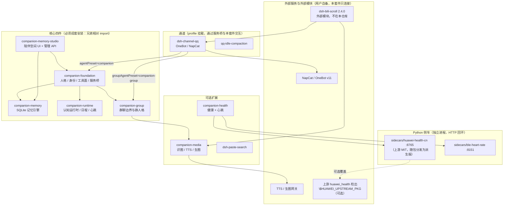

# 03 · 模块支持矩阵

> 本表回答三个问题：**哪些模块真的存在**、**它在哪个平台能用**、**它的证据到哪一级**。
> 证据分级定义见 §3。**没有证据的一律写「未验证」**——不写「应该可以」。
> 填表时点：2026-11-05。各模块负责人后续若补充证据，以他们的交接报告为准并同步本节。

## 1. 模块清单 × 平台 × 依赖 × 默认状态

「默认启用」指 `config/suite.json` 的出厂值（`core` / `memoryStudio` 为真，其余全关）。

> 包名一列按发布约定填写（`@dsh-companion/<module>`）。**以各模块 `package.json` 的 `name` 为准**；
> 模块内的 `localVersion` 是原始版本号留档，不参与依赖解析。

| 模块 | 包名 | 平台 | 外部依赖（缺了就不可用） | 默认启用 |
|---|---|---|---|---|
| `companion-foundation` | `@dsh-companion/foundation` | Win / Linux / macOS | DSH 宿主；`config/persona.md` | ✅ 是 |
| `companion-memory` | `@dsh-companion/memory` | Win / Linux / macOS | Node ≥ 24（`node:sqlite`）；语义检索需用户自备 embedding 服务 | ✅ 是（`backend` 默认 `legacy`，见 `docs/02` §7） |
| `companion-memory-studio` | `@dsh-companion/memory-studio` | Win / Linux / macOS | 同上（成套安装）+ 宿主 Web UI | ✅ 是 |
| `companion-runtime` | `@dsh-companion/runtime` | Win / Linux / macOS | 同上；联网探索需 `dsh` 搜索 | ✅ 是 |
| `companion-group` | `@dsh-companion/group` | Win / Linux / macOS | 需 QQ 通道才有群会话 | ✅ 是（装了但没有通道就不生效） |
| `dsh-channel-qq` | `@dsh-companion/channel-qq` | Win（实机）／Linux·macOS 未验证 | **NapCat / OneBot v11 外部服务**；QQ 登录 | ❌ 否 |
| `qq-idle-compaction` | （随通道） | 同通道 | 同上 | ❌ 否（`modules.qqIdleCompaction`） |
| `companion-media` | `@dsh-companion/media` | Win（实机）／其余未验证 | TTS / 生图服务（可选，缺省即关闭）；识图可走云端模型 | ❌ 否 |
| `companion-health` | `@dsh-companion/health` | Win（实机）／其余未验证 | `sidecars/huawei-health-cn`（**随包分发**，需华为账号授权）与/或 `sidecars/ble-heart-rate`（BLE 设备） | ❌ 否 |
| `companion-expression` | `@dsh-companion/expression` | Win（离线测试）／其余未验证 | QQ 通道（采集与投递都走它）；无第三方库（只用 `node:sqlite`） | ❌ 否（`modules.expression` + `delivery.enabled` 两道闸） |
| `sidecars/huawei-health-cn` | —（Python） | Win（实机）／其余未验证 | Python 3.9+；华为运动健康 CN 账号。上游为 **MIT 且随包分发**（`python/` 下 3 个派生文件 + 1 个本项目自写的服务端，见 §1.2.1）；`$HUAWEI_UPSTREAM_PKG` 只是**可选覆盖** | ❌ 否 |
| `sidecars/ble-heart-rate` | —（Python） | Win（实机，真机跑通）／macOS·Linux 未验证 | Python 3.12 + `bleak`；支持心率广播的 BLE 设备（**原创代码，不受上游许可影响**） | ❌ 否 |
| `dsh-paste-search` | `@dsh-companion/paste-search` | Win / Linux / macOS | 无 | ❌ 否 |

发布树规模：**10 个插件模块 + 2 个 sidecar**（另有 `qq-idle-compaction.mjs` 作为通道随附模块）。

### 1.1 外部可选模块（**不在本仓库**）

| 模块 | 来源 | 版本 | 上面这张表里为什么没有它 |
|---|---|---|---|
| `dsh-bili-scroll`（B站值班） | `https://github.com/c1overzz/dsh-bili-scroll` | 固定 `2.4.0`（tarball），**不跟随 latest** | 第三方代码，本仓库不打包、不代管、不为许可背书 |

- 安装是**用户显式操作**：`dsh plugin --profile <profile> add <tarball URL>`
- 它自带 Python 依赖（ASR/转写虚拟环境）；**本套件不代管这个 venv**
- 默认关闭：`modules.bilibili=false`；「自动评论 / 自动投递」必须**单独**开启，且受 `safety.autoComment` 总闸
- 它的许可证与来源需用户自行核实
- 迁移时它的 `bili_credential.json` 属于**永不导出**的凭据（`docs/04` §4）

### 1.2 本版**未收录**（已从发布树删除，不是暂缓）

#### `dsh-super-injector`（超级注入器）—— 整体移除

| 阻塞 | 说明 |
|---|---|
| 上游仓库**无任何 LICENSE 文件**（GitHub API 返回 `license: null`） | 它的 `package.json` 里写着 BSD-3-Clause，但**没有正文、没有版权行**支撑；BSD-3-Clause 的署名与许可全文条款**无法履行**，因此不能分发。 |
| 无法验证 | 它的构建需要 `DSH_CHECKOUT` 指向一份 **DSH 源码检出**（`packages/`）。只装桌面版的环境**永远构建不出来**，也就无法进入任何一级验证。 |

连带移除：`plugins/_selftest-hello`（它只是注入器的冒烟夹具，没有独立价值）。

**替代做法**：需要运行时插件注入能力的人，自行从上游获取源码与许可证、自备 DSH 源码检出后构建。
本套件既不打包、也不代管、也不为其许可与行为背书。因此：

- `config/suite.json` 里**没有** `modules.superInjector` 这一项；
- 部署、配置、迁移、回滚文档里都**不再**出现注入器步骤；
- 它也不在依赖图里。

### 1.2.1 华为健康上游：**MIT，已随包分发**（2026-11-05 核实）

这一条曾经是「不分发」，现在改成「分发」，因为许可与来源都已经核实清楚：

| 文件 | 是什么 | 来源 | 许可 |
|---|---|---|---|
| `python/client.py` | 云端读取客户端（`HuaweiHealthClient`、`Tokens`、`health_series`…） | **上游派生副本** + A1 适配 | MIT（and7ey） |
| `python/const.py` | 端点 / 主机 / 运动类型常量表 | **上游派生副本** + A1 适配 | MIT（and7ey） |
| `python/huawei_login.py` | 三步登录探针（`url` → `exchange` → `probe`） | **上游派生副本** + A1 / A2 适配 | MIT（and7ey）+ 本项目适配 |
| `python/huawei_dashboard.py` | 只读 HTTP 服务端，提供 `GET /api/data?days=N` | **本项目自写**（上游**没有**这个文件，A3） | MIT（本项目） |

| 事实 | 结论与依据 |
|---|---|
| 上游许可 | `and7ey/huawei_health` = **MIT**（GitHub API `license.spdx_id = "MIT"`，`Copyright (c) 2026 and7ey`）；许可全文随包放在 `sidecars/huawei-health-cn/UPSTREAM-LICENSE.txt`，派生文件头也各带 provenance 注释块 |
| 我们是副本还是派生 | **派生分发，不是逐字节副本**：3 个派生文件含 A1（路径解析）/ A2（uid 打码与凭据落盘）两处适配；**协议行为未改动**（端点、字段名、单位、时间口径与 `PROTOCOL-FREEZE.md` §2–§8 一致）。原冻结提交 `1ec3e41…`（分支 `cn-hosts-default`）**已 404**，上游当前 main 只剩 `client.py`/`const.py` 且大小不同（32833/4781 vs 33877/5415），所以**无法再做逐字节复核** |
| 哪些是第三方、哪些是我们自己的 | **3 个派生 + 1 个自写**：`client.py`/`const.py`/`huawei_login.py` 是第三方派生（受 MIT 署名义务约束）；`huawei_dashboard.py` 是**本项目原创**（MIT，本项目版权），**不计入**第三方清单。登记见 `THIRD-PARTY-NOTICES.md` 与 `python/README.md` 的逐文件表 |
| 是否可以这样分发 | MIT 允许派生分发，前提是**保留版权声明与许可全文**（`UPSTREAM-LICENSE.txt` 已满足） |
| 使用者要不要自备上游 | **不需要**：`start-sidecar.*` 默认入口就是随包的 `python/huawei_dashboard.py`，开箱只差一次账号授权。`$HUAWEI_UPSTREAM_PKG` 只是**可选覆盖**（追新 / 对照），设了才与上游做 diff |

```bash
# 可选：只想覆盖成你自己的上游检出时才需要设
export HUAWEI_UPSTREAM_PKG="/path/to/your/huawei_health/custom_components/huawei_health"
```

> **BLE 心率通道与本条完全无关**——`sidecars/ble-heart-rate` 是原创实现，不依赖华为账号、上游或 sidecar。

### 1.3 明确**不实现**的外部协议（**已核实**，不是「证据不足」）

| 协议 | 核实结论 | 处理 |
|---|---|---|
| Index-TTS | 上游 `index-tts/index-tts` 的 `LICENSE` 首行是 **bilibili Model Use License Agreement**（自定义模型使用协议，GitHub `license.spdx_id = NOASSERTION`，**非开源许可**）；文件树里**没有文档化的 HTTP JSON 接口**——可交互面只有 `webui.py`（Gradio）、Triton 后端、内部 `openvoice/api.py`，没有可核实的「请求字段 / 响应 / 鉴权」契约 | **不实现 adapter**，也不猜它的 Gradio 内部协议。这是**已核实**的结论（不是「我们还没排期」，也不是「证据不足」） |

> 许可与来源的完整登记见 `THIRD-PARTY-NOTICES.md` 的「未随仓库分发（以及原因）」表与
> 其下的「Index-TTS 为什么标『尚未接入』」小节；本节只做索引，不重复法务细节。

## 2. 模块依赖图

### 2.1 装载关系（谁 import 谁 / 谁挂谁）



> 图里**没有** `dsh-super-injector`：这一版不收录它（原因见 §1.2）。

### 2.2 文字版（便于 grep / 复制）

```
companion-foundation
 ├─→ companion-memory         （记忆引擎实例；优先复用 studio 提供的共享服务）
 ├─→ companion-runtime        （认知状态注入、日程与事件桥）
 └─→ companion-group          （群人格常量 + 工具闸门，仅对 qq-group-* 生效）

companion-memory-studio
 ├─→ companion-foundation
 └─→ companion-memory         （通过共享服务，不自己开第二个写入者）

dsh-channel-qq
 ├─→ 通过 profile 挂载 companion-*（agentPreset=companion，groupAgentPreset=companion-group）
 └─→ 外部 OneBot/NapCat（ws）

companion-health
 ├─→ sidecars/huawei-health-cn（:8765，只读聚合数据）
 │    └─→ 上游实现随包分发（MIT；python/ 下是含 A1/A2 适配的派生版本）
 │         $HUAWEI_UPSTREAM_PKG 只是可选覆盖：设了用你自己的上游，不设用包内的
 └─→ sidecars/ble-heart-rate （:8151，HRS 0x180D/0x2A37 实时心跳；原创代码，无上游依赖）

companion-media               独立（不 import 兄弟模块；外部 TTS/生图服务可选）

dsh-paste-search              独立（UI 入口）

（dsh-super-injector 不在本版发布范围，见 §1.2）
```

**为什么「必须成套安装」**：核心四件之间是**兄弟相对 import**（`../companion-memory/...`），
不是裸包名导入。单独 `npm i @dsh-companion/memory` 只会得到解不开的相对路径。
本仓库用 npm workspaces 把 `plugins/*` 放在同一父目录下，正是为了让这套相对 import 成立。

**信息所有权**（改配置前值得看一眼）：

| 数据 | 唯一写入者 |
|---|---|
| 记忆 / 证据 / 修订链 / Wiki | `companion-memory` |
| 事件 / 目标 / 信念 / 工作记忆 / 日程 / 活动 | `companion-runtime` |
| 动作、投递状态与收据 | 通道（`dsh-channel-qq`）的 contact / reminders |
| 健康派生统计 | `companion-health`（`health.db`） |
| 媒体作业账本 | `companion-media` |

## 3. 证据分级（五个词，别自创）

| 级别 | 含义 | 可接受的证据形式 |
|---|---|---|
| `offline-test` | 离线单元 / 集成测试通过 | `node --test`（或模块自有 verify）的通过计数与日期 |
| `host-load` | 宿主**实际加载**成功（插件被 DSH 装载、服务注册、无加载错误） | 宿主启动日志里的插件装载记录 / `--dump-config` 合成结果 |
| `real-api` | 真实外部 API 调通（模型、TTS、生图、向量等） | 一次真实请求的成功响应 + 时间 |
| `real-send` | 真实平台**发送成功**（QQ 消息、B站评论等） | 平台返回的消息 id / 可复核的页面上线 |
| `hardware` | 真机硬件实测 | 设备名、读数、时间窗口 |

**表述纪律**：

- `offline-test` 通过 **不等于** `host-load` 通过 **不等于** 能用。
- CI 绿 = `offline-test` + 构建通过。**CI 通过不是桌面实机验证**。
- 「配置已保存」「连接测试成功」「真的发出去了」是三件不同的事（`docs/02` §6）。

## 4. 当前证据矩阵

两列证据必须分开看：**发布树**（本仓库代码）与**生产系统历史**（原作者运行的那套，只能当参考，
不能当本仓库的验收）。

### 4.1 发布树证据（本仓库）

实测口径与证据锚点见 `docs/07` §2.1（提交 `cebcb84`，Windows + 宿主 `0.2.1-rc.3`，2026-11-05）。

| 模块 | offline-test | host-load | real-api | real-send | hardware |
|---|---|---|---|---|---|
| `companion-foundation` | **213 / 204 通过 / 0 失败 / 9 跳过** | **✅**（真实宿主启动，无 `did not activate`） | 未验证 | — | — |
| `companion-memory` | **268 通过 / 0 失败** | **✅** | 未验证 | — | — |
| `companion-memory-studio` | **115 通过 / 0 失败** | **✅**（UI 返回 HTTP 200） | 未验证 | — | — |
| `companion-runtime` | **697 通过 / 0 失败** | **✅** | 未验证 | — | — |
| `companion-group` | **10 通过 / 0 失败** | **✅** | — | 未验证 | — |
| `dsh-channel-qq` | **1208 / 1207 通过 / 0 失败 / 1 跳过** | 未验证（验收未启用通道） | 未验证 | **未验证** | — |
| `companion-media` | 通过（计数未单独汇总） | 未验证（验收未启用该模块） | 未验证 | 未验证 | — |
| `companion-health` | 通过（计数未单独汇总） | 未验证（验收未启用该模块） | 未验证 | — | 未验证 |
| `companion-expression` | 见 `docs/07` §2.6（本轮离线测试计数） | **✅**（真宿主装载，两行都装上、无 `did not activate`） | 未验证 | **未验证** | — |
| `sidecars/huawei-health-cn` | 见负责人交接报告（含 `test_protocol_contract.py` / `test_redact.py`） | — | **未验证**（需要真实华为账号；代码路径与 MIT 许可已就位） | — | — |
| `sidecars/ble-heart-rate` | 见负责人交接报告（`--fixture` 可无硬件跑） | — | — | — | 未验证 |
| `dsh-paste-search` | **无测试** | 未验证（验收未启用该模块） | — | — | — |
| ~~`dsh-super-injector`~~ | **未收录**（原因见 §1.2），无证据也不应有 | — | — | — | — |
| `tools/migrate`（迁移 CLI） | **10 项离线测试通过**（`node --test tools/migrate/test/migrate.test.mjs`）；并在**真实数据副本**上跑通 `export`（976 条记忆，VACUUM INTO 快照）/ `check` / `import --dry-run` | — | — | — | — |

> 「✅ host-load」的依据是**真实宿主启动日志里没有一条 `did not activate`**，且 doctor 的 profile
> 合成（311 个条目）与 `compose`（194 个 loader 行）都通过；**不等于能对话**——会话需要真实模型调用，
> 那属于 `real-api`，仍未验证。
>
> 「计数未单独汇总」= 该模块在 `unit` 里是绿的，但负责人的分项数字还没并进本文；**不要当成「已通过」**。

### 4.2 生产系统历史证据（**不是**本仓库的验收）

这些是原作者那套系统在 2026-10 至 11 月留下的记录，只能说明「这条路径曾经跑通过」，**不能**说明
本发布树在用户机器上能跑通。

| 能力 | 历史证据到哪一级 | 说明 |
|---|---|---|
| 桌面陪伴对话（人格 + 记忆注入） | `real-api` | 曾用真实模型完成会话 |
| 长期记忆写入 → 检索 → 注入 | `real-api` | 曾完成「记住 → 另开会话问出来」的闭环 |
| QQ 私聊 / 群聊收发 | `real-send` | 曾用真实 NapCat 收发（有平台消息 id） |
| 提醒（`qq_remind`） | `real-send` | 生产开过真发，队列空 |
| 主动联系（contact） | 仅到 `host-load`/模拟 | 切 turn 模式后**没有**真实主动发送的证据 |
| B站自动评论 | `real-send` | 曾有 2 条评论 rpid（外部模块，不在本仓库） |
| BLE 心率 | `hardware` | 真机手环广播跑通，端到端出【心跳读数】行 |
| 华为健康 | `real-api`（**原作者环境**） | 上游为 MIT、代码随包分发，这条证据**不能直接算本发布树的**：本仓库需要一次真实账号授权才算 `real-api` |
| 媒体生图 / Breeze TTS | `real-api` | 有真实作业与产物；**投递通道是 mock**，`confirmed` 被强制改写 `unknown` |
| 实时语音（sidecar） | 隔离环境 | 延迟未达标，未接 QQ 通话 |

### 4.3 结论怎么说才准确

- 「本仓库当前状态」：核心五模块 + 陪伴空间 UI 到 **`host-load`**（真实宿主装载、UI 200、可干净停止），
  全部模块到 **`offline-test`**；**`real-api` / `real-send` / `hardware` 未验证**。
- 「跑在哪些平台上」：Windows 实机通过（含**空格 + 中文**路径）；**Linux / macOS 未验证**。
- 「这套设计曾经到过哪里」：见 4.2，但那是原作者机器上的系统。
- 任何文档、README、UI 都**不得**把 4.2 写成 4.1 的成绩。

## 5. 已知缺口（按模块）

| 模块 | 已知缺口 | 影响 |
|---|---|---|
| `dsh-channel-qq` | 构建产物不入库，clone 后必须 `npm run build`；`main` 不得指向带日期目录（已列为发布硬规则） | 忘记构建 → `doctor` 报模块入口缺失 |
| `companion-media` | 识图默认关闭；投递通道 mock；**Index-TTS 明确不实现**（上游非开源许可 + 无文档化 HTTP 契约，见 §1.3） | 「发出去了」不会被证明 |
| `companion-health` | 四个能力（上下文注入 / 习惯记忆 / 日程调整 / 主动关怀）本轮代码里没有读取分支 | 开关存在但无效，`docs/02` §3.6 已注明 |
| `companion-group` | 无独立测试目录；群内媒体/自主接话在历史上无真实证据 | 群里发图/发语音属未验证 |
| `companion-expression` | **未验证**：GIF 关键帧理解、OCR、embedding 向量召回、QQ 内置 `face` 投递全部未实现；真实平台发图未验收 | 图库可用、决策可算、管理入口可看，但「真的发出去了」没有证据（`docs/07` §2.6） |
| `companion-expression`（默认开关） | 补丁块默认关：`modules.expression=true` 才会挂载；模块内另有 `delivery.enabled` 第二道闸 | 没开模块时侧栏「表情包」页面会自己给出启用片段，不是坏掉 |
| 实时语音 | 不在发布树（实验态 sidecar） | 不要承诺它可用 |
| B站 | 外部模块 | 版本、许可、Python 环境都由用户负责 |
