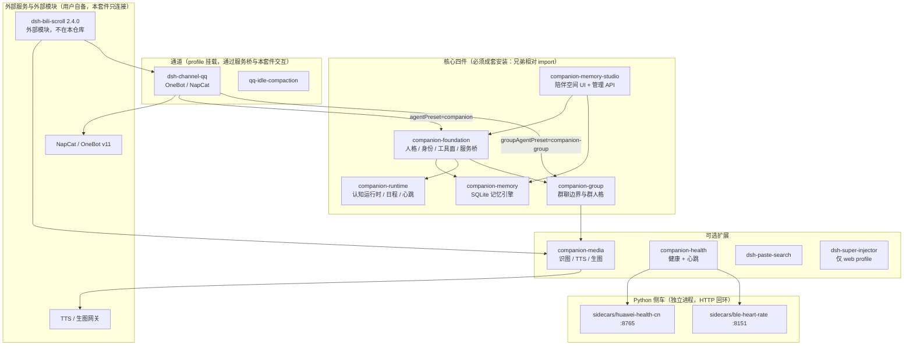

# 03 · 模块支持矩阵

> 本表回答三个问题：**哪些模块真的存在**、**它在哪个平台能用**、**它的证据到哪一级**。
> 证据分级定义见 §3。**没有证据的一律写「未验证」**——不写「应该可以」。
> 填表时点：2026-11-05。各模块负责人后续若补充证据，以他们的交接报告为准并同步本节。

## 1. 模块清单 × 平台 × 依赖 × 默认状态

「默认启用」指 `config/suite.json` 的出厂值（`core` / `memoryStudio` 为真，其余全关）。

> 包名一列按发布约定填写（`@dsh-companion/<module>`）。**以各模块 `package.json` 的 `name` 为准**；
> 模块内的 `localVersion` 是原始版本号留档，不参与依赖解析。

| 模块 | 包名 | 平台 | 外部依赖（缺了就不可用） | 默认启用 |
|---|---|---|---|---|
| `companion-foundation` | `@dsh-companion/foundation` | Win / Linux / macOS | DSH 宿主；`config/persona.md` | ✅ 是 |
| `companion-memory` | `@dsh-companion/memory` | Win / Linux / macOS | Node ≥ 24（`node:sqlite`）；语义检索需用户自备 embedding 服务 | ✅ 是（`backend` 默认 `legacy`，见 `docs/02` §7） |
| `companion-memory-studio` | `@dsh-companion/memory-studio` | Win / Linux / macOS | 同上（成套安装）+ 宿主 Web UI | ✅ 是 |
| `companion-runtime` | `@dsh-companion/runtime` | Win / Linux / macOS | 同上；联网探索需 `dsh` 搜索 | ✅ 是 |
| `companion-group` | `@dsh-companion/group` | Win / Linux / macOS | 需 QQ 通道才有群会话 | ✅ 是（装了但没有通道就不生效） |
| `dsh-channel-qq` | `@dsh-companion/channel-qq` | Win（实机）／Linux·macOS 未验证 | **NapCat / OneBot v11 外部服务**；QQ 登录 | ❌ 否 |
| `qq-idle-compaction` | （随通道） | 同通道 | 同上 | ❌ 否 |
| `companion-media` | `@dsh-companion/media` | Win（实机）／其余未验证 | TTS / 生图服务（可选，缺省即关闭）；识图可走云端模型 | ❌ 否 |
| `companion-health` | `@dsh-companion/health` | Win（实机）／其余未验证 | `sidecars/huawei-health-cn`（华为账号授权）与/或 `sidecars/ble-heart-rate`（BLE 设备） | ❌ 否 |
| `sidecars/huawei-health-cn` | —（Python） | Win（实机）／其余未验证 | Python 3.9+；华为运动健康 CN 账号 | ❌ 否 |
| `sidecars/ble-heart-rate` | —（Python） | Win（实机，真机跑通）／macOS·Linux 未验证 | Python 3.12 + `bleak`；支持心率广播的 BLE 设备 | ❌ 否 |
| `dsh-paste-search` | `@dsh-companion/paste-search` | Win / Linux / macOS | 无 | ❌ 否 |
| `dsh-super-injector` | `@dsh-companion/super-injector` | Win / Linux / macOS | 宿主 `web` profile（不在陪伴桌面加载） | ❌ 否 |
| `_selftest-hello` | `@dsh-companion/selftest-hello` | — | 无（注入器夹具，非发布功能） | ❌ 否 |

### 1.1 外部可选模块（**不在本仓库**）

| 模块 | 来源 | 版本 | 上面这张表里为什么没有它 |
|---|---|---|---|
| `dsh-bili-scroll`（B站值班） | `https://github.com/c1overzz/dsh-bili-scroll` | 固定 `2.4.0`（tarball），**不跟随 latest** | 第三方代码，本仓库不打包、不代管、不为许可背书 |

- 安装是**用户显式操作**：`dsh plugin --profile <profile> add <tarball URL>`
- 它自带 Python 依赖（ASR/转写虚拟环境）；**本套件不代管这个 venv**
- 默认关闭：`modules.bilibili=false`；「自动评论 / 自动投递」必须**单独**开启，且受 `safety.autoComment` 总闸
- 它的许可证与来源需用户自行核实
- 迁移时它的 `bili_credential.json` 属于**永不导出**的凭据（`docs/04` §4）

## 2. 模块依赖图

### 2.1 装载关系（谁 import 谁 / 谁挂谁）



### 2.2 文字版（便于 grep / 复制）

```
companion-foundation
 ├─→ companion-memory         （记忆引擎实例；优先复用 studio 提供的共享服务）
 ├─→ companion-runtime        （认知状态注入、日程与事件桥）
 └─→ companion-group          （群人格常量 + 工具闸门，仅对 qq-group-* 生效）

companion-memory-studio
 ├─→ companion-foundation
 └─→ companion-memory         （通过共享服务，不自己开第二个写入者）

dsh-channel-qq
 ├─→ 通过 profile 挂载 companion-*（agentPreset=companion，groupAgentPreset=companion-group）
 └─→ 外部 OneBot/NapCat（ws）

companion-health
 ├─→ sidecars/huawei-health-cn（:8765，只读聚合数据）
 └─→ sidecars/ble-heart-rate （:8151，HRS 0x180D/0x2A37 实时心跳）

companion-media               独立（不 import 兄弟模块；外部 TTS/生图服务可选）

dsh-paste-search              独立（UI 入口）
dsh-super-injector            独立（web profile，运行时注入本地插件）
```

**为什么「必须成套安装」**：核心四件之间是**兄弟相对 import**（`../companion-memory/...`），
不是裸包名导入。单独 `npm i @dsh-companion/memory` 只会得到解不开的相对路径。
本仓库用 npm workspaces 把 `plugins/*` 放在同一父目录下，正是为了让这套相对 import 成立。

**信息所有权**（改配置前值得看一眼）：

| 数据 | 唯一写入者 |
|---|---|
| 记忆 / 证据 / 修订链 / Wiki | `companion-memory` |
| 事件 / 目标 / 信念 / 工作记忆 / 日程 / 活动 | `companion-runtime` |
| 动作、投递状态与收据 | 通道（`dsh-channel-qq`）的 contact / reminders |
| 健康派生统计 | `companion-health`（`health.db`） |
| 媒体作业账本 | `companion-media` |

## 3. 证据分级（五个词，别自创）

| 级别 | 含义 | 可接受的证据形式 |
|---|---|---|
| `offline-test` | 离线单元 / 集成测试通过 | `node --test`（或模块自有 verify）的通过计数与日期 |
| `host-load` | 宿主**实际加载**成功（插件被 DSH 装载、服务注册、无加载错误） | 宿主启动日志里的插件装载记录 / `--dump-config` 合成结果 |
| `real-api` | 真实外部 API 调通（模型、TTS、生图、向量等） | 一次真实请求的成功响应 + 时间 |
| `real-send` | 真实平台**发送成功**（QQ 消息、B站评论等） | 平台返回的消息 id / 可复核的页面上线 |
| `hardware` | 真机硬件实测 | 设备名、读数、时间窗口 |

**表述纪律**：

- `offline-test` 通过 **不等于** `host-load` 通过 **不等于** 能用。
- CI 绿 = `offline-test` + 构建通过。**CI 通过不是桌面实机验证**。
- 「配置已保存」「连接测试成功」「真的发出去了」是三件不同的事（`docs/02` §6）。

## 4. 当前证据矩阵

两列证据必须分开看：**发布树**（本仓库代码）与**生产系统历史**（原作者运行的那套，只能当参考，
不能当本仓库的验收）。

### 4.1 发布树证据（本仓库）

| 模块 | offline-test | host-load | real-api | real-send | hardware |
|---|---|---|---|---|---|
| `companion-foundation` | 见负责人交接报告 | 未验证 | 未验证 | — | — |
| `companion-memory` | 见负责人交接报告 | 未验证 | 未验证 | — | — |
| `companion-memory-studio` | 见负责人交接报告（`build:client --check`） | 未验证 | 未验证 | — | — |
| `companion-runtime` | 见负责人交接报告 | 未验证 | 未验证 | — | — |
| `companion-group` | 见负责人交接报告 | 未验证 | — | 未验证 | — |
| `dsh-channel-qq` | 见负责人交接报告 | 未验证 | 未验证 | **未验证** | — |
| `companion-media` | 见负责人交接报告（M4） | 未验证 | 未验证 | 未验证 | — |
| `companion-health` | 见负责人交接报告 | 未验证 | 未验证 | — | 未验证 |
| `sidecars/huawei-health-cn` | 见负责人交接报告 | — | 未验证 | — | — |
| `sidecars/ble-heart-rate` | 见负责人交接报告（`--fixture` 可无硬件跑） | — | — | — | 未验证 |
| `dsh-paste-search` | 见负责人交接报告 | 未验证 | — | — | — |
| `dsh-super-injector` | 见负责人交接报告 | 未验证 | — | — | — |
| `tools/migrate`（迁移 CLI） | **10 项离线测试通过**（2026-11-05，`node --test tools/migrate/test/migrate.test.mjs`）；并在**真实数据副本**上跑通 `export`（976 条记忆，VACUUM INTO 快照）/ `check` / `import --dry-run` | — | — | — | — |

> 「见负责人交接报告」= 该模块负责人给出的计数尚未汇总进本文；不要把它当成「已通过」，
> 具体数字以 `release-tools/` 下的模块交接报告为准。

### 4.2 生产系统历史证据（**不是**本仓库的验收）

这些是原作者那套系统在 2026-10 至 11 月留下的记录，只能说明「这条路径曾经跑通过」，**不能**说明
本发布树在用户机器上能跑通。

| 能力 | 历史证据到哪一级 | 说明 |
|---|---|---|
| 桌面陪伴对话（人格 + 记忆注入） | `real-api` | 曾用真实模型完成会话 |
| 长期记忆写入 → 检索 → 注入 | `real-api` | 曾完成「记住 → 另开会话问出来」的闭环 |
| QQ 私聊 / 群聊收发 | `real-send` | 曾用真实 NapCat 收发（有平台消息 id） |
| 提醒（`qq_remind`） | `real-send` | 生产开过真发，队列空 |
| 主动联系（contact） | 仅到 `host-load`/模拟 | 切 turn 模式后**没有**真实主动发送的证据 |
| B站自动评论 | `real-send` | 曾有 2 条评论 rpid（外部模块，不在本仓库） |
| BLE 心率 | `hardware` | 真机手环广播跑通，端到端出【心跳读数】行 |
| 华为健康 | `real-api` | sidecar 有真实数据（账号授权） |
| 媒体生图 / Breeze TTS | `real-api` | 有真实作业与产物；**投递通道是 mock**，`confirmed` 被强制改写 `unknown` |
| 实时语音（sidecar） | 隔离环境 | 延迟未达标，未接 QQ 通话 |

### 4.3 结论怎么说才准确

- 「本仓库当前状态」：详见上表 4.1。大部分模块到 `offline-test`，`host-load` 与 `real-*` **未验证**。
- 「这套设计曾经到过哪里」：见 4.2，但那是原作者机器上的系统。
- 任何文档、README、UI 都**不得**把 4.2 写成 4.1 的成绩。

## 5. 已知缺口（按模块）

| 模块 | 已知缺口 | 影响 |
|---|---|---|
| `dsh-channel-qq` | 构建产物不入库，clone 后必须 `npm run build`；`main` 不得指向带日期目录（已列为发布硬规则） | 忘记构建 → `doctor` 报模块入口缺失 |
| `dsh-super-injector` | 构建脚本需跨平台（不能依赖 `bash`）；`lib/` 的处理以根 `.gitignore` 为准 | 忘记构建 → 入口缺失 |
| `companion-media` | 识图默认关闭；投递通道 mock | 「发出去了」不会被证明 |
| `companion-health` | 四个能力（上下文注入 / 习惯记忆 / 日程调整 / 主动关怀）本轮代码里没有读取分支 | 开关存在但无效，`docs/02` §3.6 已注明 |
| `companion-group` | 无独立测试目录；群内媒体/自主接话在历史上无真实证据 | 群里发图/发语音属未验证 |
| 实时语音 | 不在发布树（实验态 sidecar） | 不要承诺它可用 |
| B站 | 外部模块 | 版本、许可、Python 环境都由用户负责 |
